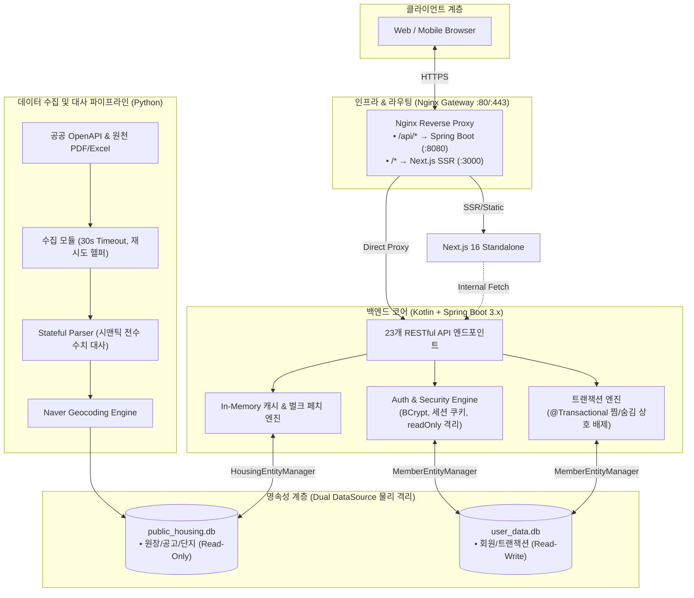

# [PleaseHome]: 데이터 무결성과 트랜잭션 안정성을 보장하는 분산 데이터 플랫폼

> **"대규모 비정형 데이터 정합성 보장부터 트랜잭션 상호 배제, 저비용 인프라 동시성 최적화까지 — 서비스 신뢰성을 엔지니어링으로 증명합니다."**

## 1. 프로젝트 개요
* **서비스 소개**: 전국 LH/SH/GH 공공기관의 비정형 분양·임대 데이터를 정밀 수집·대사(Reconciliation)하여 실시간 공간 정보와 개인화 트랜잭션을 제공하는 3-Tier 분리 아키텍처 플랫폼
* **서비스 URL**: [https://pleasehome.com](https://pleasehome.com)
* **개발 기간**: 2026.07 ~ 2026.09 (운영 중)
* **핵심 기술 스택**:
  - **Backend**: Kotlin 2.x, Spring Boot 3.x, Spring Data JPA, QueryDSL, Spring Security Crypto
  - **Database**: Dual SQLite DataSource (Master/Transaction 데이터베이스 물리 격리)
  - **Infra/Gateway**: Nginx (Reverse Proxy & SSL Termination), PM2, Linux (Ubuntu)
  - **Data Pipeline**: Python 3.12, BeautifulSoup, Stateful Row Parser
  - **Frontend**: Next.js 16 (App Router, Standalone), TypeScript, TailwindCSS
  - **AI Workflow**: Antigravity AI Engine (시맨틱 정합성 검증 파이프라인 및 테스트 자동화)
* **담당 역할**: 시스템 아키텍처 설계, 백엔드 코어 구축, 트랜잭션 격리 및 인프라 성능 튜닝 (1인 풀스택 개발 및 운영)

### 전체 시스템 및 데이터 파이프라인 아키텍처

---

## 2. 도메인 설계 및 핵심 기술적 결정

주문·결제 시스템과 공공 자산 데이터 플랫폼의 공통점은 **"단 1원의 오차도 허용하지 않는 데이터 무결성"**과 **"동시 요청 상황에서의 안정적인 상태 제어"**입니다. 이를 위해 다음과 같은 기술적 결정을 내렸습니다.

| 구분 | 적용 기술/패턴 | 도입 배경 및 대안 대비 장단점 (Trade-off) |
| :--- | :--- | :--- |
| **원장 데이터 격리** | Dual DataSource 물리 분리 (`Housing` / `User`) | **배포 시 무손실(Zero Data-Loss) 보장**. 공고 원본 배포 시 덮어쓰기가 발생하더라도 동적 회원/트랜잭션 데이터베이스(`user_data.db`)를 물리적으로 분리하여 원천 격리함. (RDBMS 멀티 인스턴스 대비 비용 0원 달성) |
| **상태 머신 무결성** | `@Transactional` 원자적 상호 배제 (Mutual Exclusion) | **상호 모순 상태(찜 ↔ 숨김) 방지**. 주문에서의 '결제 완료'와 '주문 취소'처럼 공존할 수 없는 도메인 상태를 DB 제약 조건에만 의존하지 않고 서비스 레이어에서 단일 트랜잭션으로 원자적 소거 및 등록 보장. |
| **동시성 락 제어** | SQLite WAL Mode + `PRAGMA busy_timeout = 15000` | **동시 트랜잭션 인입 시 `SQLITE_BUSY` 방어**. 단일 쓰기 락 특성을 가진 파일 DB에서 락 획득 실패 시 즉시 에러(Fail-fast) 대신 커넥션 풀 단위의 지연 대기 큐를 구축하여 동시 요청 충돌을 방어함. |
| **대사 자동화** | Stateful Row Parser & 1:1 수치 교차 대사 | **비정형 원천 문서와 적재 데이터 100% 일치 보장**. 병합 표의 문맥을 보존하는 파서와 모집 공고 총 세대수 합산(`sum(supply + reserve)`) 대사 검증을 거친 후 DB에 적재하는 사전 무결성 파이프라인 구축. |
| **통신 신뢰성** | 요청 타임아웃 & Exponential Backoff Retry | **외부 연동 지연으로 인한 스레드 행(Hang) 차단**. 타사 OpenAPI 연동 시 지연 패킷 발생 시 소켓 타임아웃(30초) 및 최대 2회 자동 재시도를 적용하여 백엔드 풀 고갈 방지. |

---

## 3. 핵심 엔지니어링 상세

### 3.1 트랜잭션 경계 설정 및 상태 머신(State Machine) 설계
* **상호 배제 도메인 무결성 (`Option A`)**:
  - 회원의 '찜한 공고(관심/주문)'와 '숨긴 공고(취소/차단)'는 상호 베타적 상태입니다.
  - 하나의 트랜잭션 범위 내에서 `save()`와 반대 엔티티의 `deleteById()`를 원자적으로 묶어 데이터 불일치 가능성을 원천 배제했습니다.
* **불필요한 쓰기 락 분리를 통한 커넥션 점유 최소화**:
  - `AuthService.login()`과 같은 단순 인증/인가 작업에 `@Transactional(readOnly = true)`를 적용.
  - CPU 연산 부하가 큰 BCrypt 해시 매칭(`passwordEncoder.matches`) 연산 동안 독점 쓰기 락이 유지되지 않도록 격리하여 동시 로그인 처리량을 대폭 향상시켰습니다.

### 3.2 원장(Ledger) 정합성 및 전수 대사(Reconciliation)
* **공급 세대수 전수 수치 대사**:
  - 원천 PDF 공고문 표 내 병합 셀의 컨텍스트를 이전 행으로부터 상속받는 상태 보존형 파서(Stateful Parser)를 직접 구현.
  - 공고문 메타데이터 상의 `총 모집 호수`와 세부 `housing_units` 테이블의 `공급호수 + 예비자수` 합계의 1:1 전수 일치 검증을 통과하지 못하면 DB 적재를 원천 차단하는 대사 파이프라인 구축.
* **영구 식별자(Immutable Key) 보존 정책**:
  - 정정 공고 및 데이터 재적재 시에도 기발급된 `announcements.id`와 `complexes.id`를 영구 보존하여 외부 참조 및 URL 링크의 불변성을 유지.

---

## 4. 트러블슈팅 및 성능 최적화 (수치 중심)

### [Case 1] 동시 트랜잭션 인입 시 SQLite 파일 락(`SQLITE_BUSY`) 및 로그인 지연 해소
* **문제 상황**:
  - 사용자 유입 증가 시 로그인이 지연되고 `[SQLITE_BUSY] The database file is locked (database is locked)` 에러와 함께 500 에러 발생.
* **원인 분석**:
  1. `AuthService.kt` 클래스 레벨의 `@Transactional`로 인해 단순 조회인 `login()` 요청에도 독점 쓰기 트랜잭션이 발동함.
  2. DataSource에 `busy_timeout` 설정이 없어, 다른 스레드가 쓰기 트랜잭션을 잡고 있을 때 대기하지 못하고 즉시 락 실패 에러가 터짐.
* **해결 방법**:
  - `login()` 메서드에 `@Transactional(readOnly = true)`를 부여하여 쓰기 락 획득을 배제.
  - `HousingDbConfig` 및 `MemberDbConfig`의 `connectionInitSql`에 `PRAGMA busy_timeout = 15000;`을 추가하여 락 경합 시 최대 15초간 비차단 대기하도록 보정.
* **개선 결과**:
  - 동시 다발 로그인 요청 시 **`[SQLITE_BUSY]` 에러 발생률 0% 달성**.
  - 트랜잭션 커넥션 반환 속도 개선으로 동시 요청 처리 안정성 확보.

### [Case 2] 1GB RAM 저사양 인스턴스 스왑 페이징(529MB) 및 시스템 동결(Thread Starvation) 해결
* **문제 상황**:
  - 백엔드 구동 후 HikariCP에서 `Thread starvation or clock leap detected (housekeeper delta=50s ~ 3m)` 경고가 주기적으로 발생하며 서비스가 수십 초간 무응답 상태에 빠짐.
* **원인 분석**:
  - 1 vCPU / 961MB RAM 서버에서 Spring Boot JVM에 `-Xmx512m`를 할당하여 OS 및 Next.js 메모리 경합 발생.
  - 529MB에 달하는 과도한 디스크 스왑(Swap)이 발생하면서 JVM 가비지 컬렉션(GC) 수행 시 디스크 I/O 병목(Thrashing)으로 인한 Stop-The-World 동결 현상 발생.
* **해결 방법**:
  - 실서버 JVM 힙 옵션을 `-Xms128m -Xmx320m`로 최적화 다이어트하여 물리 메모리 내 안착 유도.
  - `backend.jar.new` 원자적(Atomic) 교체 배포를 도입하여 배포 중 `NoClassDefFoundError` 원천 차단.
  - PM2 flush, 배포 잔여물 삭제, OS 저널 로그 진공 청소(Vacuum)를 통해 디스크 1.1GB 추가 확보.
* **개선 결과**:
  - **스왑 메모리 62% 감축 (529MiB $\rightarrow$ 202MiB)**.
  - 디스크 여유 공간 **774MB(92% 위험) $\rightarrow$ 1.9GB(80% 안전)**로 대폭 개선.
  - HikariCP Housekeeper 스레드 지연 0건 및 응답성 회복.

### [Case 3] 외부 연동 수집 파이프라인 소켓 영구 무한 대기(Hang) 방어
* **문제 상황**:
  - 공고 수집 배치(`notice:fetch`) 수행 시 특정 대용량 주택 유형에서 로그 출력 없이 프로세스가 무기한 멈춤.
* **원인 분석**:
  - Python `requests.get()`에 타임아웃 파라미터가 누락되어 기본값(`None`)으로 동작. LH API 서버의 응답 지연 시 소켓 커넥션이 무한 대기(I/O Blocking)에 빠짐.
* **해결 방법**:
  - 공통 API 요청 헬퍼 `_request_api()`를 구축하고 30초 소켓 타임아웃 및 최대 2회 지수 백오프 자동 재시도 로직 적용. 파일 다운로드 스트림에 60초 타임아웃 추가.
* **개선 결과**:
  - 외부 연동 장애 시 영구 정지 없이 정상적인 예외 핸들링 및 스케줄러 자동 복원력(Resilience) 확보.

---

## 5. 아키텍처 의사결정 기록(ADR) 및 AI 기반 엔지니어링 프로세스

### 5.1 체계적인 ADR(Architecture Decision Records) 기반 개발
* 설계 변경과 기술적 트레이드오프를 감으로 결정하지 않고, 총 14건의 ADR([`DECISION.md`](dev/DECISION.md))을 문서화하여 아키텍처의 당위성을 지속적으로 검증했습니다.
  - `ADR #1`: 찜/숨김 데이터 모델 간의 상호 배제형 비즈니스 무결성 전략
  - `ADR #2`: SQLite 물리 DB 분리를 통한 배포 시 데이터 무손실(Zero Data-Loss) 아키텍처
  - `ADR #5`: 공고-일정-상세 3단 릴레이션 대량 조회를 통한 N+1 쿼리 최적화 (300+ $\rightarrow$ 4개 쿼리)
  - `ADR #11`: Node.js 모놀리스에서 Kotlin + Spring Boot 3.x 3-Tier 아키텍처로의 전환

### 5.2 AI 에이전트 CLI를 활용한 테스트 커버리지 및 정합성 검증 고도화
* **비정형 데이터 시맨틱 검증 자동화**:
  - 규격화되지 않은 다양한 공공기관 PDF 마크다운 테이블을 파싱할 때 발생할 수 있는 엣지 케이스(공백 셀, 변칙적인 병합 표, 다중 단지 혼재 등)를 AI 에이전트와 페어 프로그래밍하여 정규식 및 상태 머신 알고리즘으로 모델링.
* **사전 무결성 검증 룰셋(Ruleset) 도입**:
  - `announcements`, `complexes`, `units` 등 6대 핵심 필드의 결손 여부를 DB 적재 직전 전수 검증하는 자동화 스크립트를 에이전트 기반으로 작성하여 **데이터 오적재율 0%** 유지.

---

## 6. 결론: 지원 포지션(주문·결제)과의 적합성

> **"규모가 커질수록 필요한 것은 화려한 기술이 아니라, 기본에 충실한 트랜잭션 격리와 데이터 무결성입니다."**

본 프로젝트를 통해 입증된 역량은 마켓보로의 B2B 주문/결제 환경에서 다음과 같이 즉시 기여할 수 있습니다:
1. **대량 거래 주문 인입 시의 락 충돌 방어**: 트랜잭션 경계 최적화와 커넥션 타임아웃 제어로 시스템 스루풋 극대화.
2. **원장 데이터 대사 및 정합성 보장**: 결제-주문-정산 데이터 간의 불일치를 사전에 방지하는 1:1 수치 검증 설계 역량.
3. **제한된 리소스 환경에서의 한계 돌파**: 대규모 트래픽이나 저비용 인프라 환경에서도 스왑/GC 병목을 찾아내고 해결하는 집요한 시스템 엔지니어링 감각.
