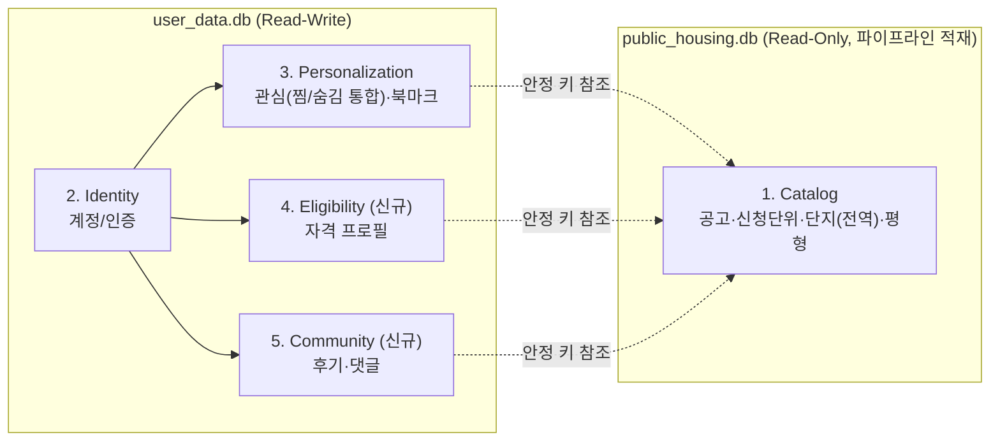

# 도메인 재설계안 (Domain Model Redesign Proposal)

본 문서는 **PleaseHome** 서비스의 도메인 경계와 DB 스키마를 재정의하는 설계안입니다. 263개 실제 공고 원문(`document.md`, LH/SH/HUG)과 현재 운영 DB(`public_housing.db`)를 실측 조사한 근거를 기반으로 확정했습니다. 실제 마이그레이션 스크립트 작성 및 `extract-data`/`audit-data` 스킬 개정은 본 문서를 기준으로 후속 진행합니다.

* **최초 작성**: 2026-09-19
* **최종 확정**: 2026-09-19 (263개 공고 원문 실사 반영)
* **범위**: 스키마 확정 (구현/마이그레이션은 후속 작업)
* **트리거**: 신규 기능(청약 자격 자동 진단, 커뮤니티/후기) 확장 + "적재할 때마다 뭔가 잘못 추출된다"는 반복 이슈의 근본 원인 규명

---

## 1. 현황 진단

기존 도메인은 `housing`(공고 카탈로그)과 `member`(회원) 2개뿐이며, 재설계 과정에서 아래 구조적 문제들을 실측으로 확인했습니다.

### 1.1 스키마 드리프트
`db_init.py`(스키마 소스 오브 트루스)에는 없는 `complexes.recruitment_group_id` 컬럼(+FK+인덱스)이 실제 운영 DB에는 존재. 버전 관리되는 마이그레이션 이력이 없어 신규 환경에서 `db_init.py`로 DB를 새로 만들면 `insert_loader.py`가 즉시 깨짐.

### 1.2 `Complex`가 공고에 종속되어 있어 실물 건물을 표현하지 못함
`complexes.announcement_id NOT NULL` 때문에 같은 물리적 건물이 공고마다(심지어 한 공고 안에서 신청단위가 다르면) **복제**됩니다. 실측 사례:

- **"강일지구 강일리버파크 2"**(공고 322): 완전히 동일한 주소가 신청단위 "강일지구"(id 372)와 "강일지구(서울리츠3호)"(id 431)에 각각 걸치면서 `complexes` 행이 2개(3950, 4009)로 복제됨. `heating_type`도 "지역난방"/"지역 난방"으로 미묘하게 달라짐.
- **"코아루 센트럴시티"**: 인천 중구→제물포구 행정구역 개편 등으로 주소 표기가 갈려 3개 공고에 걸쳐 3개의 별도 `complexes` 행으로 존재. `ComplexRepository.findHistoryList()`가 `name`+`address` **정확 일치**로만 연관 공고를 찾기 때문에 이런 경우 조용히 누락됨(145개 그룹은 정상 매칭, 123개 그룹은 이름은 같지만 주소 표기가 갈려 후보만 존재).
- 이 복제 문제의 근본 원인은 **`recruitment_group_id`가 `complexes`(단지 1개는 신청단위 1개에만 속함)에 있어서**, 실제로는 "여러 단지 → 하나의 신청단위"(N:1, 예: "경남 김해시" 신청단위 아래 평전빌/시티뷰A동/보현하우스/인제빌 4개 건물)와 "하나의 단지 → 여러 신청단위"(1:N, 강일리버파크 사례) 두 방향이 다 존재하는데 스키마가 1:N 방향을 못 받쳐줌.

### 1.3 `housing_units`의 여러 컬럼이 서로 다른 개념을 뭉쳐 담고 있음
`extract-data`/`audit-data` 스킬 문서를 대조한 결과, **규약이 있는 컬럼(title, complex.name 등)은 실제로 깨끗했고, 규약이 없는 컬럼(`room_type`, `income_group`)이 정확히 지저분했습니다.**

- **`room_type`**: 765개 distinct 값. 일부는 순번(`순번` 컬럼)이 신청유형 대신 잘못 추출된 것으로 확인(공고 83: `room_type='1형'`인 행들이 18~34㎡까지 제각각). 원본 문서 자체는 신뢰할 수 있는 공식 그룹핑(신청유형)을 담고 있음이 확인됨 — **문제는 원문이 아니라 추출**.
- **`income_group`**: 96개 distinct 값. 실측 결과 서로 다른 3가지 개념이 뭉쳐 있었음:
  1. **입주순위** (`■ 입주순위` 표, 1~4순위, 또는 영구임대류의 `가군`/`나군`) — 가족 상황 기반, 소득과 무관
  2. **임대조건/시세비율** (`■ 임대기간 및 임대조건` 표, "시중시세 30%/40%") — 수급자·차상위 여부에 따른 임대료 가격 등급
  3. **실제 소득기준** (임대조건 표의 "그 외" 칸 안에 조건부로 내포, 예: "소득 70% 이하(홑벌이)/90% 이하(맞벌이)")
  - 원문(`document.md`)에는 이 3가지가 **별도의 표로 이미 깔끔하게 분리**되어 있었음 — 역시 원문이 아니라 적재 단계에서 하나의 문자열로 뭉개진 것.
- **`target_group`**: 101개 distinct 값. "신혼부부, 예비신혼부부, 한부모가족, 유자녀혼인가구, 신생아가구"처럼 **여러 자격을 압축한 값**이 다수 — 단일 enum이 아니라 다대다 태그 구조가 필요.
- **`supply_type`**: 86개 distinct 값을 전수 분해한 결과 4개 차원(①주택상품유형 ②배정방식(일반/우선/특별) ③대상군(target_group과 중복) ④순위)이 뭉쳐 있었음.

### 1.4 263개 공고 원문 실사 결과 — 용어가 institution/subscription_type으로 고정되지 않음
"신청유형/주택형/공급형별/주택타입" 등 평형 구분 컬럼명이 subscription_type별로 깔끔하게 갈릴 거라 가정했으나, 실측 교차표 결과 대부분의 유형에서 여러 용어가 혼재함이 확인됨(2장 및 5장 동의어 사전 참고).

### 1.5 분양형(공공분양/분양전환)은 임대형과 근본적으로 다른 데이터
263개 중 22개(8%) 문서는 "분양가" 개념을 쓰고 `보증금`/`월임대료`/`보증금-월세 상호전환` 개념 자체가 없음(예: 화성동탄2 10년 분양전환 리츠 — "동호 전산추첨" 방식).

### 1.6 찜/숨김 상호배타가 앱 트랜잭션으로만 보장
`member_favorites`/`member_hidden_anns`가 별개 테이블이라, DB가 아닌 `@Transactional` 로직에만 배타성 책임이 있음.

확장 예정 기능(**청약 자격 자동 진단**, **커뮤니티/후기**)은 현재 2도메인 구조로는 담을 자리가 없습니다.

---

## 2. 제안하는 바운디드 컨텍스트



### 2.1 Catalog — `Complex`를 전역 엔티티로, `HousingUnit`을 교차점으로

핵심 원칙: **`Announcement`와 `Complex`는 서로 직접 연결되지 않고, `HousingUnit`을 통해서만 만납니다.**

```
Announcement
  ├── AnnouncementRecruitmentGroup (신청단위, Announcement에 종속)  ─┐
  └── (Complex는 전역 엔티티, 특정 공고에 종속되지 않음)            ─┤
                                                                     ▼
                                                              HousingUnit
                                               (announcement_id, complex_id,
                                                recruitment_group_id 3개를 동시 참조)
```

`RecruitmentGroup`은 Announcement 밑에 있고, `Complex`는 어디에도 종속되지 않으며, 이 둘을 `HousingUnit`이 교차 참조합니다. 상세 컬럼은 4장 참고.

### 2.2 Identity (계정/인증)
`Member`(id, pwdHash, securityQ/A, createdAt)만 유지. 개인 프로필/자격 데이터는 2.4 Eligibility로 분리.

### 2.3 Personalization (개인화)
* `MemberFavorite` + `MemberHiddenAnn` → **`AnnouncementInterest(member_id, announcement_id, status: FAVORITE|HIDDEN, updated_at)`**로 통합. `UNIQUE(member_id, announcement_id)`.
* `MemberBookmarkFolder`/`MemberBookmarkItem`은 구조 유지, `complex_id`가 전역 안정 키가 되면서 고아 참조 위험 소멸.

### 2.4 Eligibility (청약 자격 자동 진단) — 신규
* **`MemberEligibilityProfile`**(Member 1:1): 무주택기간, 세대구성원 수, 소득분위, 자산총액, 특별공급 해당유형, 최종 갱신일
* Catalog의 `housing_units.income_threshold_pct`, `housing_unit_target_tags`를 그대로 매칭에 재사용 (4장 스키마가 선행 조건)

### 2.5 Community (후기/커뮤니티) — 신규
* **`ComplexReview`**(member_id, complex_id, rating, content, created_at) — Complex 단위(전역화되었으므로 공고를 넘나드는 후기 누적이 자연스러워짐)
* **`ReviewComment`**(review_id, member_id, content)
* 신고/모더레이션은 최초 범위 제외

---

## 3. Catalog 최종 스키마 (실사 기반 확정)

### 3.1 `announcements`
```
+ source_key TEXT UNIQUE   -- "{institution}:{PAN_ID}", 모든 api_meta.json에 PAN_ID 존재 확인됨
```
나머지 컬럼 변경 없음.

### 3.2 `announcement_recruitment_groups` (신청단위) — 변경 없음
기존 구조 유지. 여러 단지를 묶는 N:1 관계는 원래도 정상 동작.

### 3.3 `complexes` (단지) — 전역화
```
- recruitment_group_id 컬럼 삭제 (housing_units로 이동)
- announcement_id: 소유 관계 → 참고용(최초 발견 공고) 메타로 격하
+ normalized_address TEXT   -- 행정구역명 개편, 접미사 유무 등을 흡수하는 정규화 주소
+ UNIQUE(name, normalized_address)
```
기존 데이터에 중복 건물이 존재하므로(실측: 이름+주소 정확일치 그룹 145개는 정상, 이름은 같으나 주소 표기가 갈린 후보 123개), 제약 적용 전 병합 마이그레이션 필요 (6장).

### 3.4 `housing_units` — 핵심 재설계

```
id, announcement_id, complex_id

+ recruitment_group_id            -- complexes에서 이동. N:1(여러 단지→한 신청단위)과
                                      1:N(한 단지→여러 신청단위, 강일리버파크 사례) 둘 다 커버

  room_number, room_count
  room_type                       -- 유지 (신청유형/주택형/공급형별/주택타입/평형 동의어 인식,
                                      원문이 신뢰 가능함을 확인했으므로 exclusive_area로 대체하지 않음)
  room_type_raw                   -- 원문 그대로 보존 (감사용)
  exclusive_area, contract_area

- supply_type (폐기, 아래로 분해)
+ housing_product_type            -- 행복주택/국민임대/매입임대/든든전세/장기전세/영구임대/
                                      공공분양/통합공공임대 등 (법정 유형, 유한 목록)
+ allocation_method                -- 일반공급/우선공급/특별공급
+ supply_type_raw

- income_group (폐기, 아래로 분해)
+ priority_rank                    -- 1순위~4순위 (가군→1순위급, 나군→2순위급 매핑)
+ priority_rank_raw
+ rent_price_tier                  -- 시중시세 대비 %(숫자, 예: 30, 40)
+ rent_price_tier_raw
+ income_threshold_pct             -- 숫자(%)
+ income_threshold_condition       -- 자유텍스트 (건설형/매입형, 홑벌이/맞벌이 등 — 공고마다 조건축이 다름)

- target_group (폐기, housing_unit_target_tags로 이동)

  supply_count, reserve_count
  deposit, monthly_rent, max_deposit, min_deposit, max_monthly_rent, min_monthly_rent
+ sale_price                       -- 분양가 (nullable, 분양형 전용. housing_product_type이
                                      '공공분양'/'분양전환'일 때만 사용, deposit/monthly_rent는 NULL)
  attributes, created_at, updated_at
```

### 3.5 `housing_unit_target_tags` (신규, 다대다)
```
housing_unit_id, tag   -- 청년/신혼부부/신생아가구/한부모가족/다자녀/고령자/주거약자/무주택세대구성원 등
```

### 3.6 분양형(공공분양/분양전환) 처리 방침
전체의 8%에 불과하고 `room_type`/`exclusive_area`/`complex_id`/태그 구조는 임대형과 동일하게 재사용 가능하므로 **별도 테이블을 만들지 않고 `sale_price` 컬럼 하나만 추가**. `housing_product_type`으로 임대/분양 분기.

---

## 4. 실사례로 검증한 설계 (요약)

| 사례 | 문제 | 해결 |
|---|---|---|
| 강일리버파크 2 (공고 322) | 한 단지가 2개 신청단위에 걸쳐 `complexes` 행 복제 | `recruitment_group_id`를 `housing_units`로 이동 → 복제 불필요 |
| 경남 김해시 신청단위 (공고 332) | 4개 다른 건물이 신청단위 하나로 묶임 | 원래도 N:1로 정상 동작, `housing_units.recruitment_group_id`로 유지 |
| 코아루 센트럴시티 | 행정구역 개편/접미사 차이로 동일 건물이 여러 `complexes` 행 | `normalized_address` + 전역 `UNIQUE(name, normalized_address)` |
| 공고 83 매입임대 | `room_type='1형'`이 18~34㎡을 다 가리킴 (순번 오추출 추정) | 원문은 신뢰 가능, 추출 규약(동의어 인식)만 보강 — 스키마는 그대로 |
| 공고 332 신혼매입임대 | `income_group`에 순위+임대조건+소득기준이 뭉침 | `priority_rank`/`rent_price_tier`/`income_threshold_pct`+`condition` 4컬럼 분해 |
| 경상남도 김해시 매입임대 | `income_group`이 "1·2순위 (시중시세 30% 수준)" (소득기준 아예 없음) | `income_threshold_pct`는 NULL 허용, `rent_price_tier`/`priority_rank`만 채움 |
| 화성동탄2 분양전환리츠 | 보증금/월세 없이 분양가만 존재 | `sale_price` 컬럼 추가, 별도 테이블은 만들지 않음 |

---

## 5. 동의어 사전 (추출/감사 규약용, `extract-data`/`audit-data` 반영 대상)

### 5.1 `room_type` 헤더 인식 (263개 문서 통계 기반)
표 헤더에 아래 중 **하나라도** 포함되면 해당 컬럼으로 인식 (subscription_type으로 고정 매핑 금지 — 실측 결과 대부분 유형에서 혼용됨):
```
신청유형(3%, 8/263), 주택형(71%, 186/263), 공급형별(49%, 129/263), 주택타입(7%, 19/263), 평형(49%, 128/263)
```

### 5.2 `allocation_method`
| 원문 표현 | 표준값 |
|---|---|
| 일반공급 | 일반공급 |
| 우선공급 | 우선공급 |
| 특별공급, 다자녀특별공급 | 특별공급 |
| (국민임대류) "모집호수의 N% 범위 내 우선배정" 룰 텍스트 | 일반공급 + `supply_note`에 원문 보존 (별도 레코드로 억지 분리 금지) |

### 5.3 `priority_rank`
| 원문 표현 | 표준값 |
|---|---|
| 1순위, 제1순위 | 1순위 |
| 2순위 / 3순위 / 4순위 | 그대로 |
| 가군 (생계·의료급여수급자 등) | 1순위급 |
| 나군 (일반 등) | 2순위급 |
| "3·4순위"처럼 합쳐진 경우 | `priority_rank_raw`에 원문 보존, 억지로 숫자 하나로 안 쪼갬 |

### 5.4 `rent_price_tier`
"시중 시세 30%", "시중시세 30%" 등 표기 변형 → 숫자만 추출(예: 30), 원문은 `rent_price_tier_raw` 보존.

### 5.5 `income_threshold_condition` (자유텍스트, 자주 나오는 패턴)
```
건설형 / 매입형 (장기전세류)
홑벌이 / 맞벌이(본인 및 배우자 모두 소득 있는 경우) (신혼매입임대류)
수급자·차상위 / 그 외
```

### 5.6 `housing_product_type` (기존 extract-data 규약 유지)
```
행복주택, 국민임대, 영구임대, 매입임대, 든든전세, 장기전세, 공공분양, 통합공공임대, 재개발임대, 집주인임대(희귀, 3/263건)
```

---

## 6. 마이그레이션 절차 (실행 순서)

1. **`recruitment_group_id`를 `complexes`에서 `housing_units`로 복사** (병합 전, 1:1로 안전하게 이관)
2. **`complexes` 중복 그룹 확정 및 병합**: `normalized_address` 정규화 함수 적용 → `(name, normalized_address)` 그룹핑 → 대표 id 선정 (좌표 보정된 행 우선) → `old_id → canonical_id` 매핑표 생성
3. **참조 리매핑**: `housing_units.complex_id`, `member_bookmark_items.complex_id`(user_data.db, 별도 파일이므로 매핑표를 양쪽에 적용) 업데이트
4. **중복 `complexes` 행 삭제** 후 `UNIQUE(name, normalized_address)` 제약 추가
5. **`housing_units` 컬럼 분해**: `supply_type`→`housing_product_type`+`allocation_method`, `income_group`→`priority_rank`+`rent_price_tier`+`income_threshold_pct`/`condition`, 5장 동의어 사전 적용
6. **`target_group` → `housing_unit_target_tags` 이관** (압축형 문자열 분해)
7. **`announcements.source_key` 백필** (`download_meta.json`의 PAN_ID 기반, NULL 허용되므로 완벽하지 않아도 진행 가능)
8. **`sale_price` 컬럼 추가** (독립적, 아무때나 가능)
9. **부수 조치**: 삭제되는 옛 `complex_id`의 sitemap URL → 대표 id로 301 리다이렉트 (SEO 손실 방지)

2번(정규화 함수)은 실제 UPDATE/DELETE 전에 SELECT만으로 dry-run하여 오병합(다른 건물을 같은 건물로 오인) 여부를 먼저 검증할 것.

---

## 7. Personalization/Eligibility/Community 적용 순서

1. Catalog 스키마 확정 및 마이그레이션 (위 6장) — 최우선, 다른 모든 것의 전제조건
2. `AnnouncementInterest` 통합 — Catalog와 독립적, 병행 가능
3. `extract-data`/`audit-data` 스킬에 5장 동의어 사전 반영
4. Eligibility 프로필 스키마 확정 — 소득/자산 기준 모델링 정교도 결정 필요 (열린 질문)
5. Community 스키마 확정 — 후기 단위(Complex vs Announcement) 결정 필요 (열린 질문)

---

## 8. 열린 질문 (남은 것만)

1. **소득/자산 기준 모델링 정교도**: `income_threshold_pct` 하나로 충분한 공고가 많은 반면, 일부는 조건부(건설형/매입형)라 `income_threshold_condition`이 필요함을 확인함 — Eligibility 매칭 정확도를 어디까지 요구할지는 여전히 열려있음
2. **후기 단위**: Complex 단위(제안, Complex 전역화로 더 타당해짐) vs Announcement 단위
3. **Kotlin 패키지 리네이밍 시점**: 스키마 마이그레이션과 함께 옮길지, 나중에 별도로 정리할지

---

## 9. 마이그레이션 실행 결과 (2026-09-19, 로컬 DB 기준)

`db-pipeline/migrations/001~007` 스크립트로 6장의 절차를 전부 실행 완료함 (`003b`, `003c`는 실행 중 발견된 문제의 보정 스크립트).

| 항목 | 결과 |
|---|---|
| `complexes` 전역 중복제거 | 3,381개 → 3,146개 (235개 병합), `UNIQUE(name, normalized_address)` 인덱스 적용 |
| 속성 충돌 해소 | ~~113건 중 32건 원문 검증 교정~~ → **정정됨(11장 참고)**: "매입다가구→다가구주택" 교정은 잘못된 추론이었음이 이후 확인되어 되돌림. 최종적으로 65건 자동 정규화, 44건(32+12) 다수결/재대조 필요로 표시 (`003_resolution_report.json`, `003_resolution_correction.json`) |
| `housing_units` 컬럼 분해 | `housing_product_type`/`allocation_method`/`priority_rank`/`rent_price_tier`/`income_threshold_pct`/`income_threshold_condition` 등 신규 컬럼 채움 |
| `housing_unit_target_tags` | 12,184건 태그 생성 (45종) |
| `announcements.source_key` | 295/295건 백필 성공. 단, `SH:0000000001`가 서로 다른 공고 2건에 중복 사용됨을 발견 — SH의 PAN_ID 채번 방식이 LH만큼 전역 유일하지 않을 가능성 있음 (UNIQUE 인덱스는 보류) |
| `announcement_interests` 통합 | `member_favorites` 16건 + `member_hidden_anns` 203건 → 219건, 충돌 0건 |
| 참조 무결성 최종 검증 | `housing_units.complex_id`, `member_bookmark_items.complex_id` 고아 참조 0건 (크로스 DB 검증) |

**당시엔 기존 컬럼/테이블을 삭제하지 않았음** — 이후 11장에서 Kotlin 백엔드 전환, `insert_loader.py`/스킬 개정까지 완료됨. 최신 상태는 11장 참고.

### 마이그레이션 진행 중 발견한 버그 2건
1. `003_merge_complexes.py`가 `UNIQUE INDEX` 생성 실패로 죽으면서 뒤에 있던 `user_data.db` 리매핑 섹션 전체가 스킵됨 → 크로스 DB 참조 무결성 검증(`orphan` 카운트)으로 발견, `003c_remap_bookmarks.py`로 보정. **앞으로도 다단계 마이그레이션 후에는 반드시 크로스 DB 고아 참조 검증을 해야 함.**
2. 리포트 파일 저장 코드가 실패 가능한 단계보다 뒤에 있어 첫 실행 시 통째로 유실됨 → 백업 DB에서 재구성, 스크립트 순서 수정.

## 11. 백엔드/프론트엔드 전환 및 파이프라인 개정 결과 (2026-09-19 후속)

### 11.1 Kotlin 백엔드 전환 — 완료
`HousingService`/`MemberInteractionService`/JPA 엔티티를 신규 스키마 기준으로 전환. **기존 API 응답 계약은 유지**(`supply_type`/`income_group`/`target_group` 등 원문 필드를 그대로 계속 반환)하여 프론트엔드 변경을 최소화함. 실서버 기동 후 실데이터로 검증:
* 강일리버파크 2(복수 신청단위 걸침), 코아루 센트럴시티(3개 공고 이력) 등 정상 응답 확인
* `npm run build` 전체 성공(3143+ 단지 페이지, 292+ 공고 페이지 정적 생성)

전환 과정에서 회귀 버그 1건 발견·수정: `HomeClientLayout.tsx`의 `displayComplexes`가 `complex.announcement_id`(이제 "최초 발견 공고" 참고용 메타일 뿐)로 필터링해 특정 공고에서 단지 목록이 0개로 잡히던 문제. `announcementUnits`의 `complex_id` 기준 교집합으로 수정. 같은 패턴(`BookmarkTab.tsx`, `DetailPanel.tsx` 비교표)도 함께 정리.

### 11.2 `insert_loader.py` 개정 — 완료 (가장 시급했던 항목)
UNIQUE 제약(`complexes.name, normalized_address`)을 건 뒤에도 파이프라인이 옛 로직(공고 범위 스코프 매칭 + `normalized_address` 미기입)을 그대로 쓰고 있어서, 다음 적재부터 다시 조용히 중복이 쌓이거나 제약 위반이 날 상황이었음. 개정 내용:
* 단지 매칭을 공고 범위(`WHERE announcement_id = ?`) → **전역**(`name`, `normalized_address` 기준)으로 변경
* 정정공고 재적재 시 `complexes`를 더 이상 삭제하지 않음 (전역 엔티티라 다른 공고의 참조가 끊길 수 있어서) — 매칭되면 UPDATE, 새 단지면 INSERT
* `recruitment_group_id`를 유닛별로 지정 가능하도록 지원(유닛 오버라이드 > 단지 기본값 폴백)
* `supply_type`/`income_group` 분해(`housing_product_type`/`allocation_method`/`priority_rank`/`rent_price_tier`/`income_threshold_pct`/`income_threshold_condition`), `target_group` 태그 분해, `source_key` 계산(충돌 시 자동 NULL 폴백)을 적재 시점에 즉시 수행 — 더 이상 별도 백필 마이그레이션이 필요 없음
* 완전히 새로운 DB(`db_init.py`로 생성)에 실제 공고 데이터를 처음부터 끝까지 적재하는 엔드투엔드 테스트로 검증

### 11.3 `db_init.py` 스키마 드리프트 정리 — 완료
새 컬럼/테이블 추가 도중, **`announcement_recruitment_groups` 테이블 자체가 애초부터 `db_init.py`에 없었다는 걸 발견** — `insert_loader.py`는 처음부터 이 테이블에 의존해왔는데, 신선한 환경에서 `db_init.py`로 DB를 만들면 항상 깨져있었음(이번 재설계의 발단이 된 `recruitment_group_id` 컬럼 드리프트보다 더 근본적인 동일 패턴의 사전 존재 버그). 지금은 실제 운영 스키마와 완전히 일치하도록 반영, 엔드투엔드 테스트로 확인함.

### 11.4 `extract-data`/`audit-data` 스킬 개정 — 완료
5장 동의어 사전을 규약/체크리스트로 반영. 추가로 이번 테스트 과정에서 발견한 원칙 2가지도 새로 추가:
* `complex_type`을 임의로 "아파트/연립주택/다세대주택" 등으로 의역하지 말고 원문 표기 그대로 적재 (아래 11.6 참고)
* `room_type`과 `순번` 컬럼 혼동 방지 규칙을 감사 Hard FAIL 목록에 추가

### 11.5 중복 컬럼 정리 — 부분 완료
`housing_units.supply_type_raw`/`income_group_raw`/`priority_rank_raw`/`rent_price_tier_raw` 4개 컬럼 삭제(`008_drop_redundant_raw_columns.py`) — 검증 결과 기존 컬럼과 100% 동일값이라 순수 중복이었음. **`supply_type`/`income_group`/`target_group`/`member_favorites`/`member_hidden_anns`는 삭제하지 않음** — 백엔드가 여전히 표시용으로 읽고 있어(의도적 하위호환 설계), 지금 지우면 서비스가 깨짐. 이 판단을 재확인한 뒤 그대로 유지하기로 함.

### 11.6 실수 발견 및 정정: "매입다가구→다가구주택" 교정은 틀렸음
`insert_loader.py`를 실제 데이터로 테스트하던 중, 244번 공고의 `data.json`이 `complex_type: "다세대주택"`을 **원본 필드로 이미 직접 갖고 있었다는 걸 확인**. 즉 4장에서 "원문 대조로 검증했다"고 판단한 근거(표의 "지자체명" 컬럼에 적힌 "매입다가구")는 건물 유형이 아니라 사업/매입 카테고리였을 가능성이 높고, `연립주택`/`다세대주택` 두 값이 애초에 정당한 독립 판단이었을 수 있음. 32건 전부 `다가구주택`으로 되돌리고 다수결로 재처리(`003_resolution_correction.json`) — 전부 `연립주택`으로 귀결(157번 공고 쪽 표본이 더 많았음). **이 32건도 여전히 "원문 재대조 필요" 상태**이며, 8장의 12건과 합쳐 총 44건이 미해결 상태임.

### 11.7 sitemap 301 리다이렉트 — 완료
`web/next.config.ts`에 `redirects()` 추가, 병합으로 삭제된 235개 옛 `complex_id` → 대표 id 매핑(`db-pipeline/migrations/complex_redirect_map.json`)을 빌드 시점에 읽어 정적 리다이렉트 테이블 생성. `next build` 시점에 평가되어 결과물에 포함되므로 배포 서버에 마이그레이션 파일이 별도로 필요하지 않음.

### 11.8 시도하지 않음 (의도적 보류)
* **Eligibility/Community 신규 테이블**: 8장의 열린 질문(소득 모델링 정교도, 후기 단위)이 아직 사용자 결정이 필요한 제품 설계 사안이라, 임의로 답을 정하고 구현하지 않음
* **"원문 재대조 필요" 44건**: 로컬에 원문이 남아있는 경우(244, 315)만 대조 가능했고, 나머지는 원문 자체가 이미 정리되어 확인 불가 — 다수결/보류 상태로 남김

## 12. 관련 문서

* [[ARCHITECTURE.md]] — 현재 3-Tier 시스템 아키텍처
* [[DECISION.md]] — ADR #1(찜/숨김 배타), #2(Dual DB) 등 기존 결정 배경
* [[TROUBLESHOOTING.md]] — 정정공고/ID 보존 관련 기존 트러블슈팅 기록
